

# YTS Terminal Manager

### One terminal to rule them all

**SSH · Telnet · Serial · SFTP · FTP · SCP · RDP · PowerShell · CMD**

Every remote session in one streamlined Windows app — with a built-in AI assistant,
a Python automation API, twelve embedded servers and Network Intelligence.
Replaces PuTTY, WinSCP — and half your toolbox.

 

 

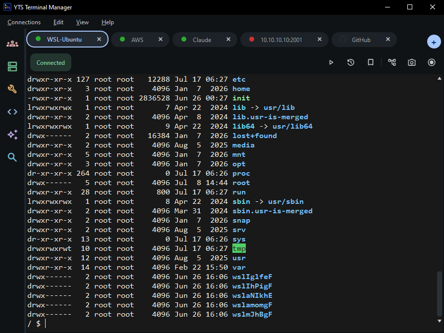

---

## What it is

**YTS Terminal Manager** is an all-in-one terminal management application for Windows, built for
network engineers, system administrators, developers, IT and power users.

Serial consoles, SSH and Telnet sessions, device web interfaces and file transfers (SFTP, FTP, SCP) 
all open as tabs in one window. They share the same favourites, session logging and keyboard shortcuts. 
The servers you usually have to find and install mid-job are built in: TFTP, SFTP, FTP, Syslog TACACS+ and more. 
and they all powered with AI capabilities.

> Download the installer from the [latest release](https://github.com/YTS-HUB/yts-terminal-manager/releases/latest)
> or from the product page, which also has release notes and system requirements:
> **https://yts-hub.com/terminal-manager/**

### New in 2.10

* **Network Intelligence** — collects events from every built-in server and from your sessions,
  recognises 28 types of network failure, groups related alarms into incidents and names the likely
  root cause.
* **SNMP trap receiver** and **iperf3 throughput testing** — twelve embedded servers in all.
* **SSH jump hosts** (up to 4) for SSH, SFTP and SCP, plus SSH certificates and the SSH agent.
* **AI Plugins** — install skills, commands, MCP connectors and device knowledge in one step
  (Claude Code plugin format).

Full changelog: **[yts-hub.com release notes](https://yts-hub.com/release-notes.html#v2-10)**

---

## Highlights

|  | |
|---|---|
| 🤖 **An AI that speaks CLI** | Reads your live terminal, understands the device you're on, and acts only with your permission. Cloud or 100% local. |
| 🧠 **Network Intelligence** | From alarm flood to root cause: related alarms from several devices become one incident, with the likely cause and the commands to confirm it. |
| 🪟 **Multi-screen** | Drag any tab out of the main window into a real standalone window — the session never drops. |
| ▦ **Multi-view layout** | Single, horizontal, vertical and matrix. Switch any time; nothing disconnects. |
| 🗄 **Twelve embedded servers** | SFTP, FTP, TFTP, TACACS+, SYSLOG, DHCP, DNS, NTP, MQTT, SNMP traps, iperf3 and a Terminal Server — no separate install. |
| 🐍 **Python automation** | A real interpreter wired to your live sessions, with an editor, console and on-connect scripts. |
| 🧰 **Diagnostics built in** | Throughput test (iperf3), port scanner, SNMP walk, ping latency graph, traceroute, Wake-on-LAN, subnet calculator. |
| 🔒 **Safe by default** | SSH host keys pinned on first use; credentials encrypted at rest with Windows DPAPI. |

---

## The AI assistant

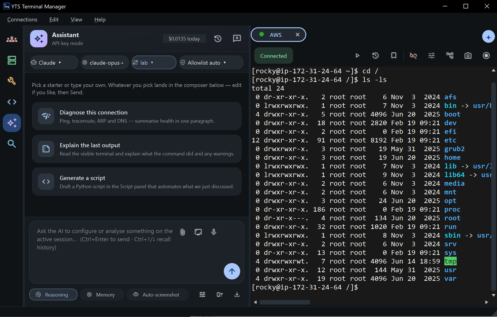

Paste nothing. Switch nowhere.

* **Diagnose** — *"Why is this BGP neighbor down?"* It reads the session output and tells you, with
  the exact `show` commands it ran.
* **Explain** — highlight any wall of output and get a plain-English explanation in seconds.
* **Generate & configure** — describe the change; it plans the commands, shows a preview, and a
  safety risk-gate asks before anything mutating runs.
* **Ask what happened** — it explains Network Intelligence incidents and, with your approval every
  time, runs read-only checks on the devices involved.
* **Extend it** — MCP connectors, Skills and Plugins (bundles of skills, commands, connectors and
  device knowledge in the Claude Code plugin format), reviewed before anything is switched on.
* **Private if you want** — run it against a local model (Ollama, LM Studio, vLLM); nothing leaves
  your machine.

Works with Anthropic Claude, OpenAI, Google Gemini, Azure OpenAI, DeepSeek, Qwen, GLM, Grok,
GitHub Copilot and Puter. Bring your own API
key — a free Gemini key works out of the box, and the assistant is entirely optional.

---

## Clients — every protocol, one window

<table>
<tr>
<td width="50%">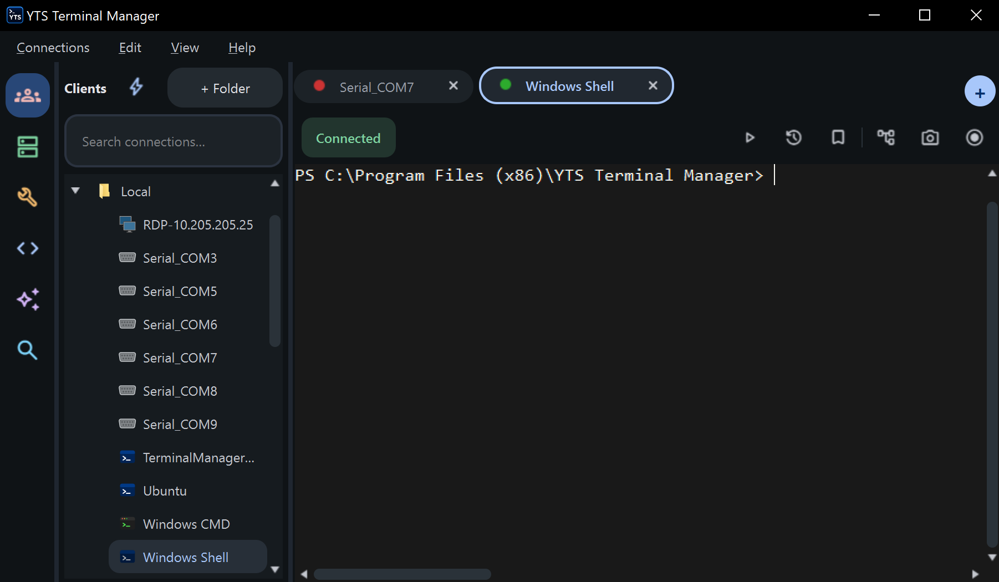</td>
<td width="50%">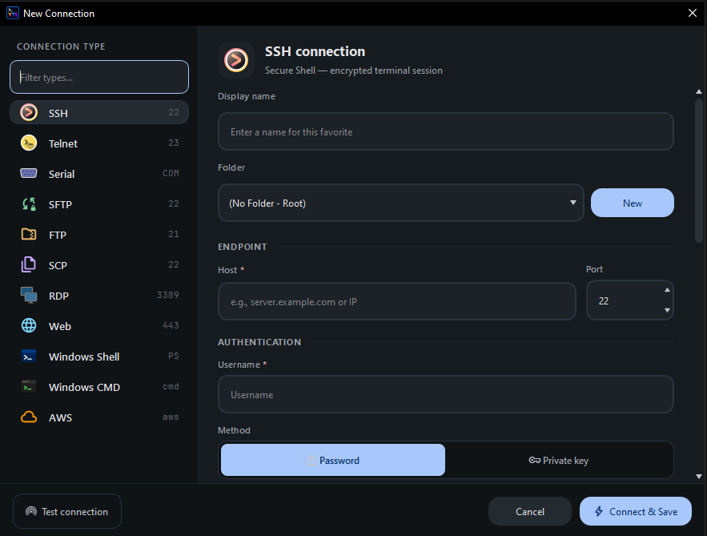</td>
</tr>
<tr>
<td align="center"><b>Favourites that scale</b> · folders, search, drag-and-drop</td>
<td align="center"><b>Ten connection types</b> · one dialog</td>
</tr>
</table>

| Group | Protocols | |
|---|---|---|
| **Remote shells** | `SSH` `Telnet` `Serial` | Routers, switches, firewalls and embedded gear — over the network, through up to 4 SSH jump hosts, or straight down an RS-232 / RS-485 console cable. |
| **File transfer** | `SFTP` `FTP` `SCP` | Drag files onto a session to upload, or browse the remote tree in a sidecar panel that follows your shell's directory. SFTP and SCP work through jump hosts too. |
| **Desktop & web** | `RDP` `Web` | Remote desktops and device management UIs open as ordinary tabs. |
| **Local & cloud shells** | `PowerShell` `CMD` `AWS CLI` | Full ConPTY terminals that run modern TUIs properly. |

**Quick-Connect** (`Ctrl+Shift+Q`) for one-line access, saved favourites for the fleet, or auto-start
so critical sessions are open before you sit down. Sign in with a password, a private key, an
OpenSSH certificate or the SSH agent.

---

## Embedded servers — twelve services, already installed

<table>
<tr>
<td width="50%">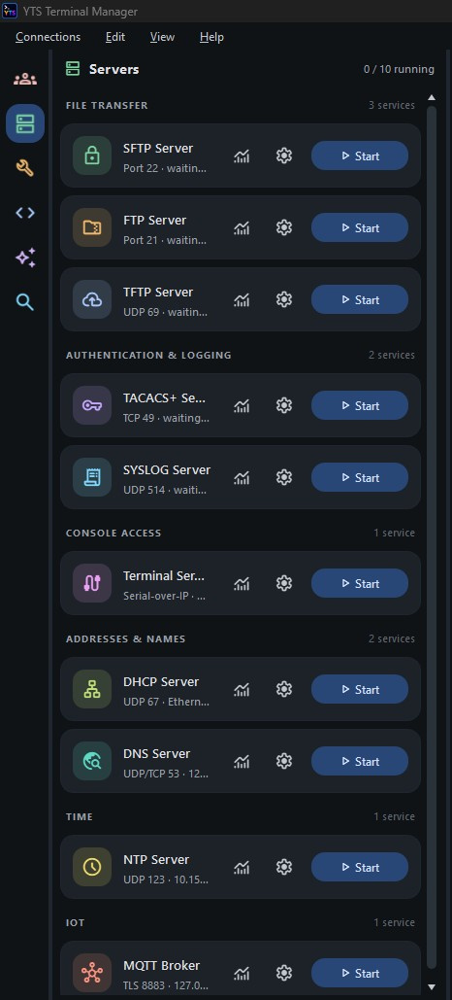</td>
<td width="50%">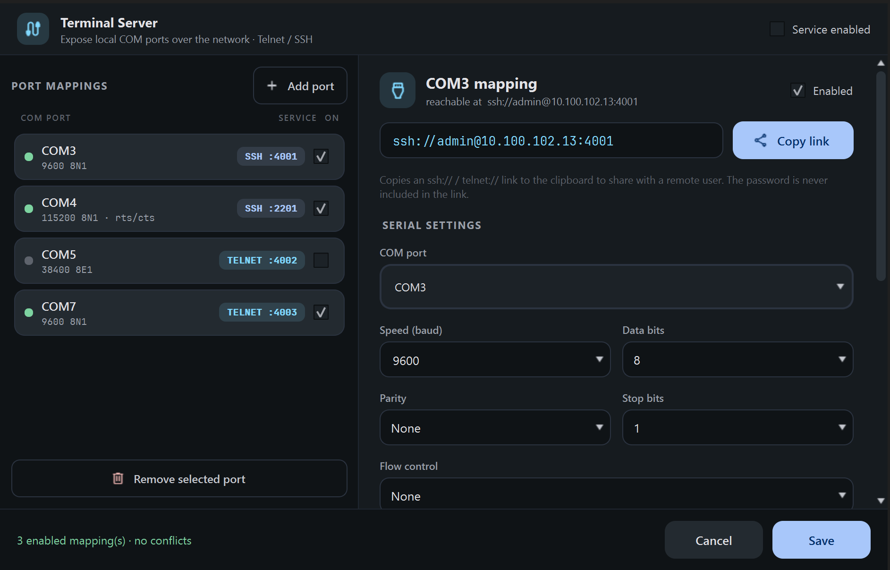</td>
</tr>
<tr>
<td align="center"><b>The stack</b> · every service grouped, started with one click</td>
<td align="center"><b>Terminal server</b> · local COM ports, reachable over SSH or Telnet</td>
</tr>
<tr>
<td width="50%">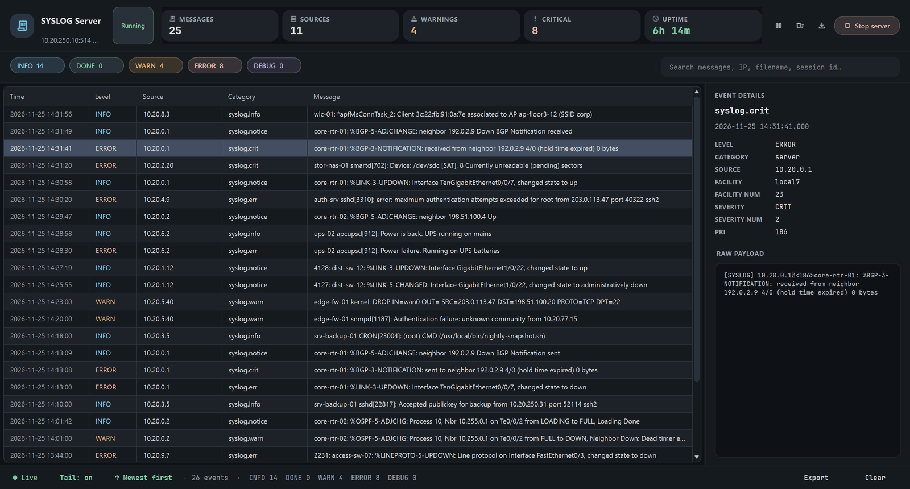</td>
<td width="50%">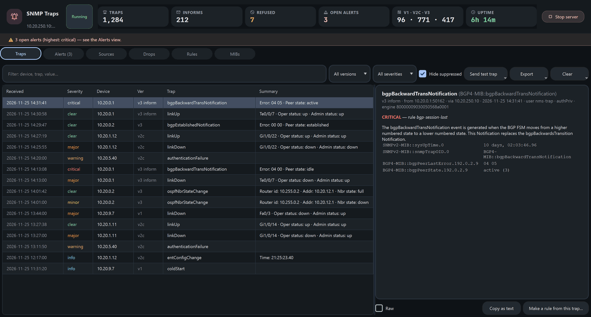</td>
</tr>
<tr>
<td align="center"><b>SYSLOG</b> · every device's messages, filtered by level</td>
<td align="center"><b>SNMP traps</b> · decoded against their MIB, with severity rules and alerts</td>
</tr>
</table>

| Group | Services | |
|---|---|---|
| **File transfer** | `SFTP · 22` `FTP · 21` `TFTP · UDP 69` | Serve a config backup or firmware image in seconds. Replaces tftpd64 and FileZilla Server. |
| **Auth & logging** | `TACACS+ · TCP 49` `SYSLOG · UDP 514` | Test AAA against a real TACACS+ server; catch a device's syslog the moment it misbehaves. |
| **Console access** | `Terminal Server` `Serial-over-IP` | Share local COM ports over SSH or Telnet — a console server in software. No hardware to buy. |
| **Network services** | `DHCP · UDP 67` `DNS · 53` `NTP · UDP 123` `MQTT · 1883` | Addresses (with PXE boot and DHCPv6), local names with fault injection, verified time and an MQTT broker with TLS for a lab network. |
| **Monitoring & testing** | `SNMP traps` `iperf3` | Receive SNMP v1, v2c and v3 traps with MIB import, severity rules and alerts, and be the far end for throughput tests from other PCs and devices. |

Every server has a structured, filterable live log viewer — not a text file.

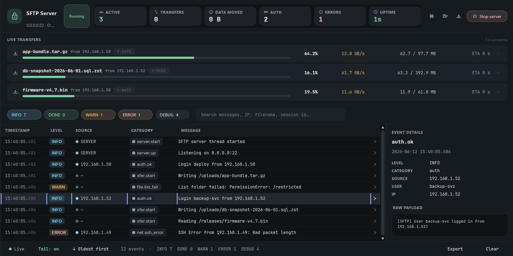

---

## Network Intelligence — see what broke, where it started

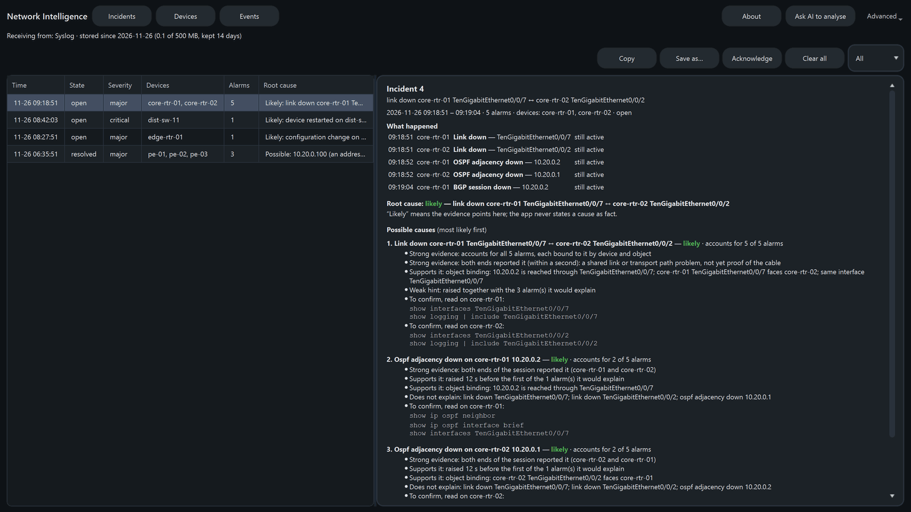

When a link drops in a live network you don't get one alarm, you get dozens: interfaces down on both
ends, OSPF neighbours lost, BGP sessions timing out, from several devices at once. Network
Intelligence does the root cause analysis for you. It collects what your devices send, recognises
the failures in it, groups related alarms into one incident, and tells you the most likely root
cause in plain words — with the evidence and the exact commands to confirm it.

* **One incident instead of fifty alarms** — a core link failure that also brought down OSPF and BGP
  on two routers shows up as one incident, not five separate problems.
* **The root cause, in words** — rated likely, possible or undetermined, with which alarms it
  explains, how they're connected, and what it does not explain.
* **Proof, not guesswork** — read-only confirmation commands written for each device involved.
* **Ready for the ticket** — copy an incident as formatted text, or save it as a web page or text file.
* **Device health** — which devices are working, degraded, silent or suspected down. Restarts are
  read from SNMP uptime, even when the cold-start trap was lost.
* **One searchable timeline** — syslog, SNMP traps (shown by MIB name) and the app's own server and
  session events, filtered by device, source, severity, text or time window.

**28 failure types out of the box:** links and transport (link down, loss of signal, E1/T1 defects,
cellular) · routing (OSPF, IS-IS, BGP, BFD) · MPLS and VPN (LDP, LSP, pseudowire, IPsec/IKE, tunnels,
DMVPN) · carrier Ethernet (G.8032 rings, CFM) · platform (restarts, CPU, memory, hardware, GNSS,
first-hop redundancy) · operations (configuration changes, login failures).

Nothing extra to install: no separate server, no agents on your devices, no cloud subscription. It
runs inside YTS Terminal Manager on your own PC, and the AI analysis is optional.

---

## Multi-view layout

One window, four ways to look at it. Focus on one device, split the window into panes, or tile the
whole fleet and watch every session react at once.

<table>
<tr>
<td width="50%"></td>
<td width="50%">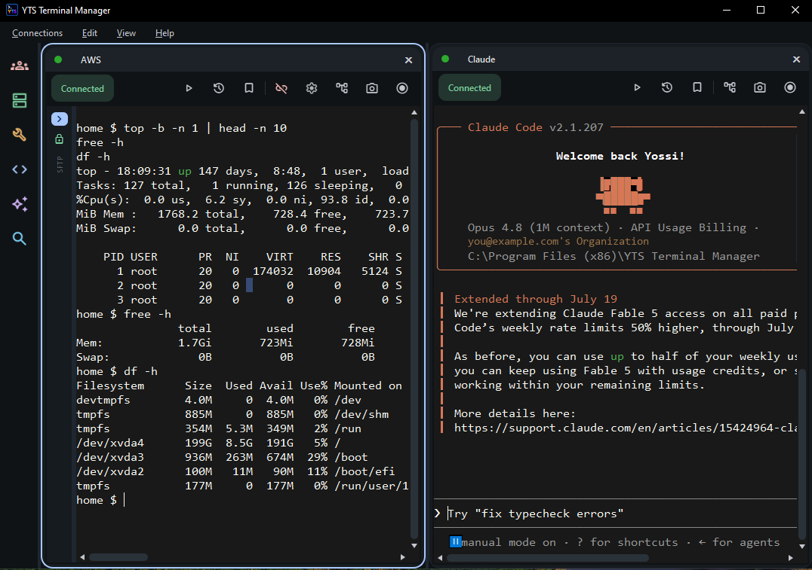</td>
</tr>
<tr>
<td align="center"><b>Single</b> · one session, full window</td>
<td align="center"><b>Horizontal</b> · two sessions side by side</td>
</tr>
<tr>
<td width="50%">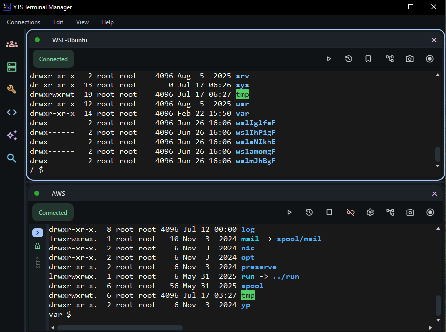</td>
<td width="50%">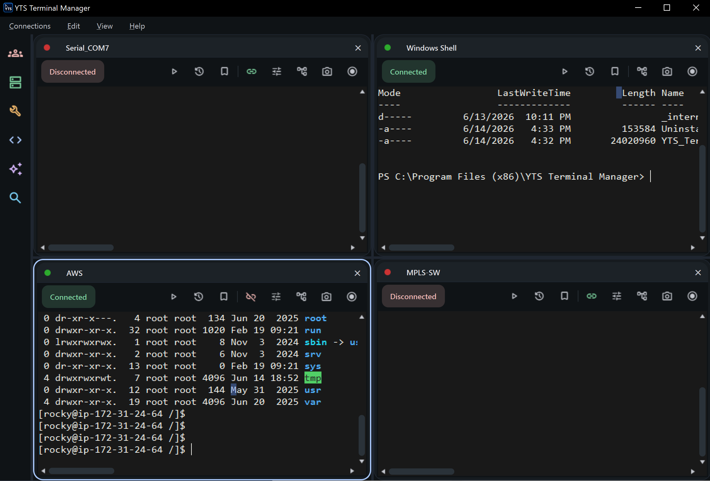</td>
</tr>
<tr>
<td align="center"><b>Vertical</b> · stacked — ideal for wide, long output</td>
<td align="center"><b>Matrix</b> · the whole fleet at a glance</td>
</tr>
</table>

Plus **multi-screen**: drag a tab out of the window entirely and drop it on your second monitor. It
becomes a real, independent window, the connection stays live, and dragging it back re-docks it.

---

## Tools — the diagnostics, built in

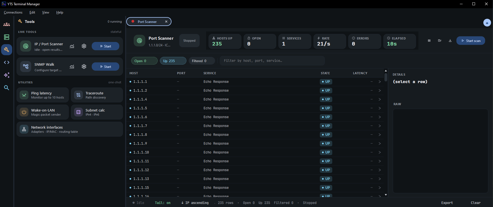

| | |
|---|---|
| **Live tools** | IP / Port Scanner (accurate open/filtered classification) · SNMP Walk (by MIB name, too) — sortable, exportable report views · Throughput Test (iperf3): TCP and UDP, parallel streams, live graphs and a history of results |
| **Utilities** | Ping latency graph (up to 10 hosts on one timeline) · Traceroute · Wake-on-LAN · IPv4 / IPv6 subnet calculator |
| **Local inspection** | Network interfaces, IP/MAC addresses and the routing table — with a jump into Windows' adapter properties |

---

## Python automation

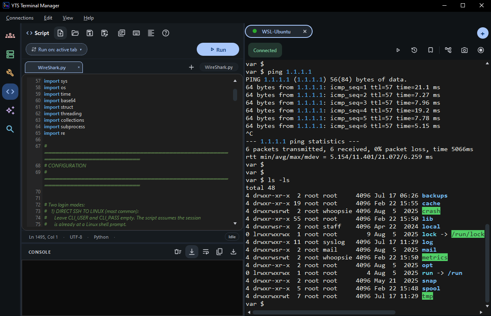

A real Python interpreter wired to your live sessions. Read the screen, send commands, drive SFTP,
even automate an embedded web page — scripted once, then run against one device or the whole fleet.

* **Run against the active tab** — output lands in the console beside the editor.
* **A real editor** — multiple script tabs, syntax highlighting, a snippet library and a formatter.
* **Terminals *and* web** — the same API navigates an embedded web tab, fills fields, clicks and runs
  JavaScript, for the device UIs that never got a CLI.
* **Fires on connect** — attach a script to a favourite and it runs the moment the session opens.

---

## Full feature list

<b>Remote access clients</b>

SSH (up to 4 jump hosts, OpenSSH certificates, SSH agent) · Telnet · Serial (RS-232 / RS-485) · SCP ·
SFTP · FTP · RDP integration · embedded web tabs · AWS CLI

<b>Embedded servers</b>

SFTP server · FTP server · TFTP server · TACACS+ server · SYSLOG server · DHCP server (PXE, DHCPv6) ·
DNS server · NTP server · MQTT broker · SNMP trap receiver · iperf3 server · Terminal Server
(serial-over-IP)

<b>Network Intelligence</b>

One event timeline for every server and session · 28 failure types turned into alarms · incidents
with a likely root cause, evidence and confirming commands · device health (working / degraded /
silent / suspected down) · restarts from SNMP uptime · copy or save incident reports · AI analysis
on request

<b>Windows integration</b>

PowerShell integration · Windows CMD integration · full ConPTY terminals

<b>Productivity</b>

Multi-tab interface · multi-view layouts (single / horizontal / vertical / matrix) · detachable tabs
for multi-monitor · command broadcasting to device groups · search across connections · session
recording · automatic session logging · drag-and-drop SSH file transfers · Python scripting inside
the terminal

<b>Network tools</b>

Throughput test (iperf3) · IP / port scanner · ping latency monitor · traceroute · SNMP walk ·
Wake-on-LAN · IPv4 / IPv6 subnet calculator · network interface & routing table inspection

<b>Terminal features</b>

VT100 emulation · large scrollback buffer · custom terminal themes · highlight rules ·
high-performance rendering engine · X11 forwarding support

<b>Security</b>

SSH host-key pinning on first use (TOFU) · credentials encrypted at rest with Windows DPAPI ·
AI risk-gate confirmation before any mutating command · no bundled software

---

## How it stacks up

| Capability | **YTS Terminal Manager** | PuTTY | WinSCP | MobaXterm Free | SecureCRT | Termius Free | Tabby |
|---|:---:|:---:|:---:|:---:|:---:|:---:|:---:|
| Price | Currently free, unlimited sessions | Free | Free | 12 sessions | Paid, from $119 per user | Free tier (Pro $10/mo) | Free, open source |
| Tabbed multi-session + matrix view | ✅ | — | — | ✅ | ✅ | ✅ | ✅ |
| Multi-screen — tear a tab into its own window | ✅ | No tabs | — | — | ✅ | — | — |
| SSH / Telnet / Serial | ✅ | ✅ | SFTP only | ✅ | ✅ | ✅ | ✅ |
| SFTP / FTP / SCP client | ✅ | — | ✅ | ✅ | SFTP (FTP in SecureFX) | SFTP only | SFTP, Zmodem |
| Built-in AI assistant (cloud + local) | ✅ | — | — | — | — | AI autocomplete only | Plugins only |
| Network Intelligence — alarms, incidents, likely root cause | ✅ | — | — | — | — | — | — |
| Command broadcast to device groups | ✅ | — | — | Multi-exec only | ✅ | ✅ | Plugin only |
| Embedded servers (SFTP, FTP, TFTP, TACACS+, SYSLOG, DHCP, DNS, NTP, MQTT, SNMP traps, iperf3) | ✅ | — | — | Partial | TFTP only | — | — |
| COM-port console server (serial-over-IP) | ✅ | — | — | — | — | — | — |
| Python automation API | ✅ | — | .NET/COM | Macros | ✅ | Snippets | Plugins |
| Port scanner, SNMP walk, subnet calc | ✅ | — | — | ✅ | — | — | — |

Comparison based on publicly documented built-in features of each product's free edition
(SecureCRT: paid licence), November 2026. All product names are trademarks of their respective
owners.

---

## Download

### [⬇ Get YTS Terminal Manager — v2.10](https://github.com/YTS-HUB/yts-terminal-manager/releases/latest)

**[Latest release on GitHub](https://github.com/YTS-HUB/yts-terminal-manager/releases/latest)** ·
**[yts-hub.com/terminal-manager](https://yts-hub.com/terminal-manager/)**

Both offer the same installer. Each GitHub release lists its SHA-256; release notes and changelog
are on the product page.

| | |
|---|---|
| **OS** | Windows 10 / 11 (64-bit) |
| **RAM** | 4 GB minimum, 8 GB recommended |
| **Disk space** | ~650 MB |
| **Install** | Standard installer — no additional runtimes |
| **Licence** | Currently free for personal and commercial use |

---

## FAQ

<b>Is it a good PuTTY alternative?</b>

It covers everything PuTTY does (SSH, Telnet, Serial) and adds tabbed multi-session views,
SFTP/FTP/SCP transfers, RDP, an AI assistant, Python automation, command broadcast and an embedded
server stack — features that would otherwise need PuTTY + WinSCP + several more tools.

<b>What is Network Intelligence?</b>

A tab that collects syslog, SNMP traps and the app's own server and session events, recognises 28
types of network failure, groups related alarms from several devices into one incident and names the
likely root cause, with the evidence and the read-only commands to confirm it. It runs on your own
PC — no separate server, no agents, no cloud subscription.

<b>Which AI models does the assistant support?</b>

Anthropic Claude, OpenAI, Google Gemini, Azure OpenAI, DeepSeek, Qwen, GLM, Grok, GitHub Copilot
and Puter — or a fully local model via Ollama, LM Studio or vLLM for air-gapped environments. You bring your own API key; a free Gemini key
works out of the box, and the assistant is entirely optional.

<b>Can it act as a console server for serial devices?</b>

Yes. The Terminal Server feature bridges local COM ports to the network over Telnet or SSH, with
per-port authentication — a software console server, built in.

<b>Is my data safe?</b>

Favourites and credentials are encrypted at rest with a per-install key sealed by Windows DPAPI.
SSH host keys are pinned on first use (TOFU) to detect man-in-the-middle attacks, and the AI
risk-gate asks before any risky command runs.

<b>Is the source code here?</b>

No — this repository is the public home for documentation, screenshots and issue reports.
YTS Terminal Manager itself is a closed-source Windows application distributed from
[yts-hub.com](https://yts-hub.com/terminal-manager/). The source of the open-source libraries it
ships (Qt, PySide6, Cygwin) is published in the
[third-party source release](https://github.com/YTS-HUB/yts-terminal-manager/releases/tag/third-party-source-2.10).

---

## More from YTS-Hub

| | |
|---|---|
| 📡 **[Ethernet Traffic Generator](https://yts-hub.com/packet-generator/)** | Multi-port, multi-stream Ethernet traffic generator and network tester for Windows — loss, latency and jitter per stream. |
| 🔌 **[Serial Traffic Generator](https://yts-hub.com/serial-generator/)** | Stress-test RS-232/RS-485 links with patterns, error injection and a visual comparator. |

---

**[yts-hub.com](https://yts-hub.com/)** · *Master the Network*

Free professional network tools for Windows. Built by an engineer, for engineers.

Questions or bugs? [Open an issue](../../issues) or use the
[contact page](https://yts-hub.com/contact/).

